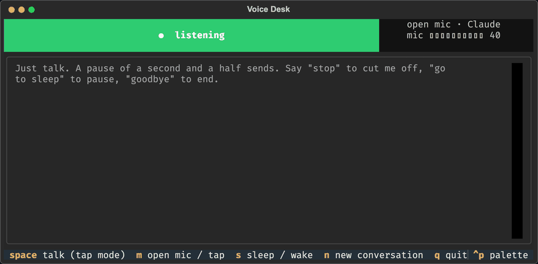
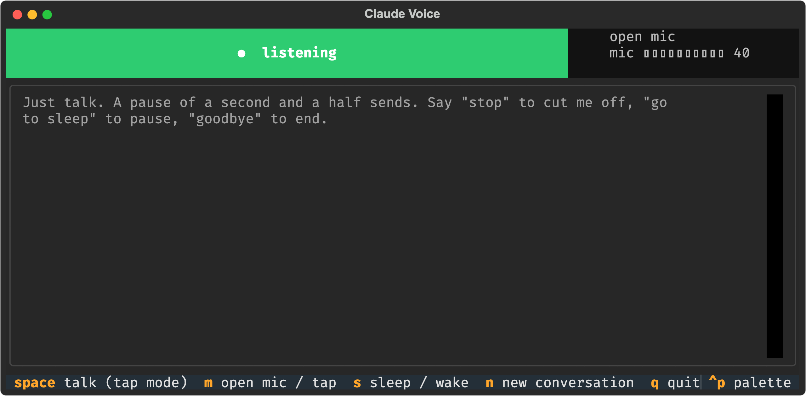
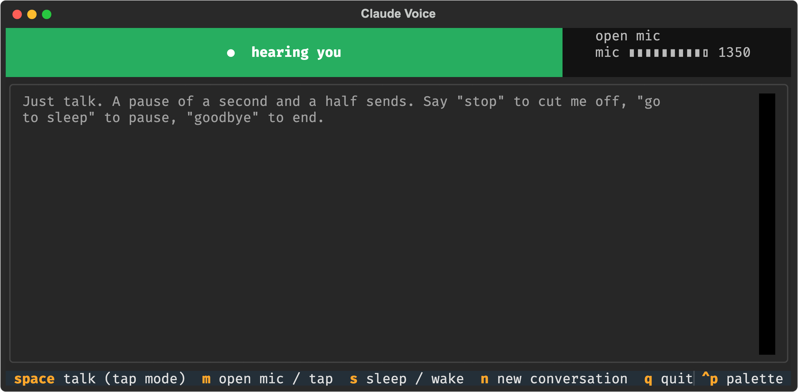
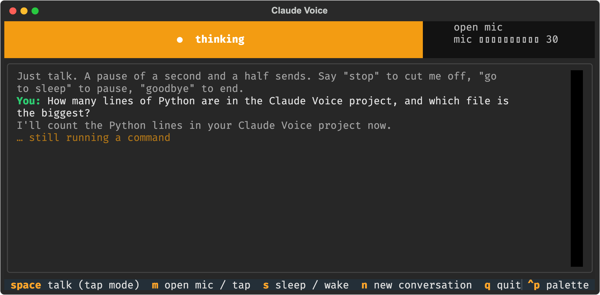
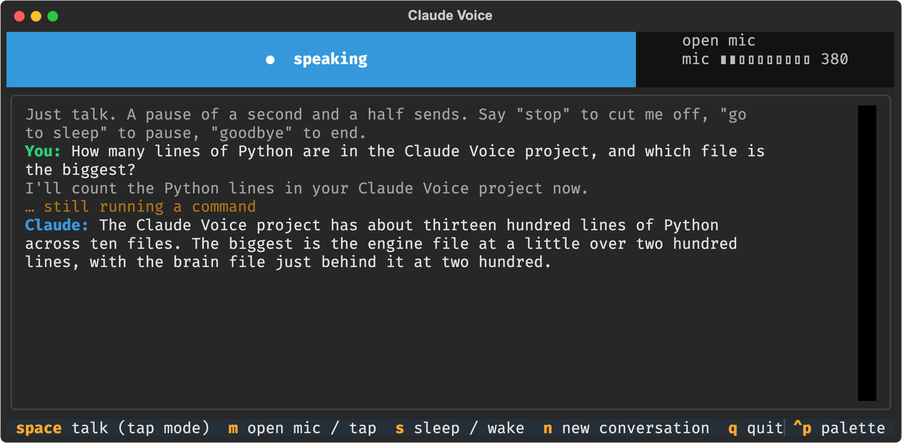
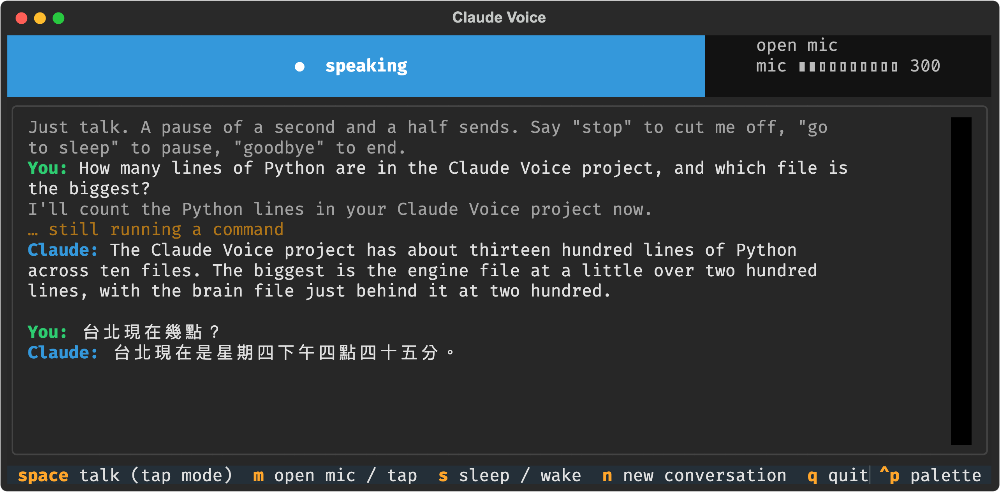
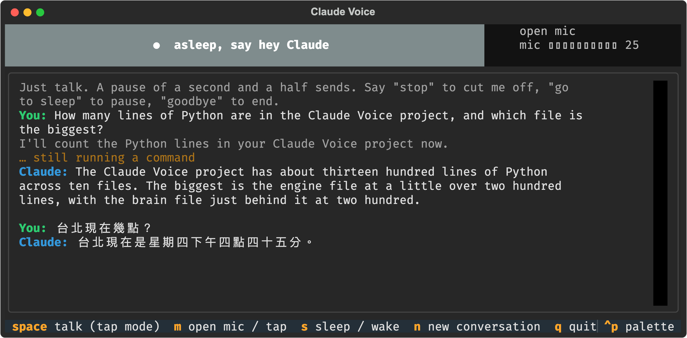
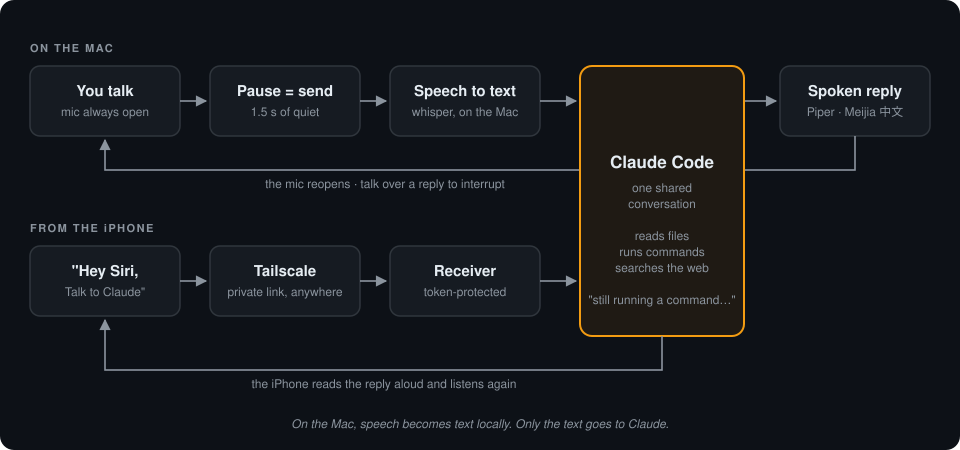

<div align="center">

# Claude Voice

**Talk to Claude Code like a phone call. Hands-free, on your Mac and your iPhone.**



    

</div>

You speak. When you pause, it sends. Claude does the work and **answers out loud**. Then
the microphone opens again for your next sentence. There's no record button, no play
button and no typing.

This isn't a chatbot with a voice bolted on. It is **the real Claude Code**, with your
files, your terminal and the web, driven by your voice. Ask it to count the lines in a
project, check why a job failed, or look something up. While it works it tells you what
it's doing ("still running a command"), so you're never left in silence.

## Why you'll like it

- **Truly hands-free.** The mic stays open. A 1.5-second pause is your "send" button.
- **It does real work.** Every turn is a full Claude Code turn: it can read, run, edit and search.
- **Talk over it.** Start speaking while it answers and it stops to listen.
- **One conversation, two devices.** Start at your desk, carry on from your iPhone with
  "Hey Siri, Talk to Claude". Both continue the same thread.
- **Your voice stays on your Mac.** Speech recognition runs locally with whisper.cpp.
  Only the transcribed text goes to Claude.
- **Bilingual.** Speak English or Mandarin, and get the answer back in the same language.
- **No API key.** It uses the `claude` command you're already logged into, on your normal subscription.
- **Change things by voice.** "Use Opus", "think deep", "go to sleep", "goodbye".

---

## See it

The window is deliberately tiny: a coloured light that tells you what's happening, a
live mic meter, and the transcript. These are screenshots of the real app, replaying a
conversation recorded from real Claude turns.

<table>
<tr>
<td width="50%"><br><b>Listening.</b> The mic is open. Just start talking.</td>
<td width="50%"><br><b>Hearing you.</b> The meter jumps when it picks up your voice.</td>
</tr>
<tr>
<td><br><b>Thinking.</b> Claude is working. Every 10 seconds it says what it's doing.</td>
<td><br><b>Speaking.</b> The answer is read aloud. Talk over it to interrupt.</td>
</tr>
<tr>
<td><br><b>中文 works too.</b> Ask in Mandarin, hear the answer in a Taiwan Mandarin voice.</td>
<td><br><b>Asleep.</b> After a minute of quiet it naps. Say "hey Claude" to wake it.</td>
</tr>
</table>

## How it works



Each step is one small Python file:

| Step | File | What it does |
|---|---|---|
| Listen | `audio.py` | Keeps the mic open and compares loudness with a background-noise level that adjusts itself. 0.25 s of sound starts a recording, 1.5 s of quiet ends it, and anything shorter than 0.4 s is ignored as a cough. No speech library needed. |
| Transcribe | `stt.py` | `whisper-server` stays loaded, so each turn takes about 1.3 s instead of reloading the model every time. It filters out whisper's habit of hallucinating "Thank you." from silence. |
| Think | `brain.py` | Runs `claude -p --resume <thread>` with a short instruction to *answer like a phone call*: one to four spoken sentences, with no code, paths or links. Long detail goes to a file instead. A file lock lets the Mac and the phone take turns on one thread. |
| Speak | `tts.py` | Strips markdown, picks an English or Mandarin voice, and plays the answer in a way that can be cut off instantly. |
| Loop | `engine.py`, `app.py` | Runs the cycle, spoken commands and sleep/wake. A [Textual](https://textual.textualize.io) window draws the light, meter and transcript. |
| Phone | `receiver.py` | A tiny token-protected web endpoint, `POST /ask {"text"} → {"reply"}`, that the iPhone Shortcut calls. |

**Measured on a 24 GB Apple Silicon Mac:** speech to text 1.2–1.6 s, a simple Claude turn
4–11 s, a turn that digs through files about 20 s, voice synthesis 2.7–4 s.

---

## Quick start

You need a Mac (Apple Silicon recommended), [Claude Code](https://claude.com/claude-code)
installed and logged in, and [Homebrew](https://brew.sh).

```bash
# 1. tools: local speech recognition + audio conversion
brew install whisper-cpp ffmpeg

# 2. the speech model (~490 MB, one time)
mkdir -p ~/.local/share/whisper-models
curl -L -o ~/.local/share/whisper-models/ggml-small.bin \
  https://huggingface.co/ggerganov/whisper.cpp/resolve/main/ggml-small.bin

# 3. the app
git clone https://github.com/Panbear1983/Claude_Voice.git && cd Claude_Voice
uv venv .venv --python 3.11          # or: python3.11 -m venv .venv
uv pip install --python .venv/bin/python -r requirements.txt

# 4. check every stage works (no mic, no window, no Claude tokens)
.venv/bin/python tests/selftest.py --no-brain

# 5. go
./start.sh
```

The first time it opens, macOS asks whether Terminal may use the microphone. Click
**Allow**. Wait for "I'm listening" and start talking.

## Talk to it

| Say | What happens |
|---|---|
| *anything, then pause* | sent to Claude |
| "stop", "wait", "hold on", 「等一下」 | cuts the answer off (or just start talking over it) |
| "go to sleep", 「休息」 | stops listening until you say "hey Claude" |
| "hey Claude, …" | wakes it up; the rest of the sentence is your question |
| "use Opus" / "switch to Sonnet" / "use Haiku" / "use Fable" | changes the model from the next question on |
| "which model" | tells you which model it's using |
| "think deep" / "quick mode" / "max effort" / "normal mode" | how hard Claude thinks |
| "which effort" | tells you the current effort level |
| "open mic" / "tap to talk" | switches listening mode (tap mode is for noisy rooms) |
| "goodbye", 「再見」 | ends the session; Claude saves a short note about what you discussed |

Ending a sentence with "over" or "send" also works, and the word is dropped.

**Keys** (you never *need* them): <kbd>Space</kbd> talk in tap mode or interrupt ·
<kbd>M</kbd> mode · <kbd>S</kbd> sleep/wake · <kbd>N</kbd> new conversation · <kbd>Q</kbd> quit.

## Take it to your iPhone

Same conversation, from anywhere, through [Tailscale](https://tailscale.com) (free for
personal use), which privately links your phone and your Mac.

```bash
./install_receiver.sh                   # starts the receiver now and at every login
.venv/bin/python make_shortcut.py       # builds a signed "Talk to Claude.shortcut"
```

Get the `.shortcut` file onto the phone (AirDrop, iCloud Drive, or send it to yourself)
and tap **Add Shortcut**. Then say **"Hey Siri, Talk to Claude"**. It listens, sends what
you said when you pause, reads the reply aloud and listens again, for up to 300 rounds.

Prefer typing on the phone? `./install_remote_control.sh` keeps a Claude Code Remote
Control session running on the Mac, so the Claude app on your phone always finds it.

## Make it yours

Everything adjustable is a plain constant in `settings.py`:

| Setting | Default | Change it to… |
|---|---|---|
| `SILENCE_SEND_SEC` | `1.5` | wait longer or shorter before sending |
| `SLEEP_AFTER_SEC` | `60` | nap sooner or later |
| `WHISPER_MODEL` | small | `large-v3-turbo` is more accurate but about 3× slower |
| `DEFAULT_MODEL` / `DEFAULT_EFFORT` | Fable / medium | your usual model |
| `TTS_VOICE_ZH_MAC` | Meijia | any Mac voice (`say -v '?'` lists them) |
| `TTS_CHAIN` / `TTS_ORDER` | optional script | your own voice pipeline (Piper, Edge…); without it, the built-in Mac voice speaks |
| `WAKE_WORDS`, `STOP_WORDS`, … | see file | your own phrases, in any language |

Claude calls you by the first name on your Mac account. Set `CLAUDE_VOICE_NAME` to
change it. Other environment overrides: `CLAUDE_VOICE_STATE`, `CLAUDE_VOICE_TTS_ORDER`,
`CLAUDE_VOICE_CLAUDE_BIN`, `CLAUDE_VOICE_WHISPER_PORT`, `CLAUDE_VOICE_RECEIVER_HOST`,
`CLAUDE_VOICE_RECEIVER_PORT`.

## Safety, in plain words

- **Claude runs with full permissions.** It won't stop to ask before running a command,
  which is what makes hands-free possible. Treat it like a trusted terminal you control by voice.
- **The phone receiver is only as safe as its token.** By default it listens on your home
  network and Tailscale. Anyone with the token who can reach your Mac could talk to Claude
  as you. The token is random, kept in a private file and inside the Shortcut, and never
  committed. To allow Tailscale only, set `CLAUDE_VOICE_RECEIVER_HOST` to your Mac's
  Tailscale address. To rotate the token, delete `~/.claude_voice/receiver_token`, restart
  the receiver and rebuild the Shortcut.
- **It won't hear itself.** Each voice turn sets `CLAUDE_VOICE_LOOP=1`, so Claude Code hooks
  can skip anything that would speak twice. While the window is open, it holds
  `~/.claude_voice/window.lock`, which other read-aloud hooks can check. That stops the
  open mic from mistaking another session's spoken answer for you.

<details>
<summary><b>Where things are kept</b></summary>

Nothing personal lives in the repo. The app's memory is `~/.claude_voice/`:

| File | Holds |
|---|---|
| `session_id` | the shared conversation thread |
| `model`, `effort` | your spoken model / effort choice |
| `receiver_token` | the phone's password (owner-only) |
| `transcript.log` | every question and answer, time-stamped |
| `detail.md` | long answers Claude chose not to read aloud |
| `window.lock`, `turn.lock` | "window open" and "turn running" markers |
| `receiver.log`, `remote-control.log` | background job logs |

</details>

<details>
<summary><b>Troubleshooting</b></summary>

| Symptom | Fix |
|---|---|
| Mic meter stays at 0 | System Settings → Privacy & Security → Microphone → allow your terminal |
| "already open in another window" | only one window at a time; close the other |
| Light stuck on *hearing you* | room too loud for open mic; press <kbd>M</kbd> for tap mode |
| It answers things you didn't say | something else on the Mac is talking; mute it or use tap mode |
| iPhone Shortcut fails | Tailscale off on the phone, the receiver isn't running (`curl http://<mac-tailscale-ip>:8765/health`), or a very long turn outlasted the Shortcut's wait |
| A new conversation started by itself | you opened the voice thread in another `claude --resume` window and left it open; read it, then quit |
| Slow to start speaking | your `TTS_ORDER` tries a voice that keeps failing first; reorder it |

</details>

<details>
<summary><b>Testing and regenerating these screenshots</b></summary>

```bash
.venv/bin/python tests/selftest.py              # every stage, including two real Claude turns
.venv/bin/python tests/selftest.py --no-brain   # everything except Claude (no tokens)
```

The self-test needs no mic and no screen. It checks the silence detector on synthetic
audio, whisper on a spoken sample, both voices, that Claude remembers a code word across
two turns, and that the window opens and switches mode.

```bash
.venv/bin/python docs/screenshots.py   # real window, headless, replaying docs/demo_conversation.json
python3 docs/render_images.py          # PNGs + loop.gif (needs playwright + Pillow)
```

</details>

<details>
<summary><b>File map</b></summary>

| File | Role |
|---|---|
| `start.sh` | double-click launcher |
| `app.py` | the window: light, transcript, mic meter, keys |
| `engine.py` | listen → think → speak loop, spoken commands, sleep / wake |
| `audio.py` | microphone, pause detection, talk-over detection |
| `stt.py` | whisper-server control and transcript cleanup |
| `brain.py` | the Claude thread, model / effort switching, spoken status |
| `tts.py` | read-aloud cleanup, voice choice, playback |
| `settings.py` | every adjustable value |
| `receiver.py`, `start_receiver.sh`, `install_receiver.sh` | iPhone receiver and its login job |
| `make_shortcut.py` | builds the signed iPhone Shortcut |
| `install_remote_control.sh` | Remote Control login job for the Claude app |
| `tests/selftest.py` | headless end-to-end check |
| `docs/` | screenshots, diagram and the scripts that make them |

</details>

## Built with

[Claude Code](https://claude.com/claude-code) ·
[whisper.cpp](https://github.com/ggerganov/whisper.cpp) ·
[Textual](https://github.com/Textualize/textual) ·
[sounddevice](https://python-sounddevice.readthedocs.io) ·
[Tailscale](https://tailscale.com) · macOS Shortcuts and voices
